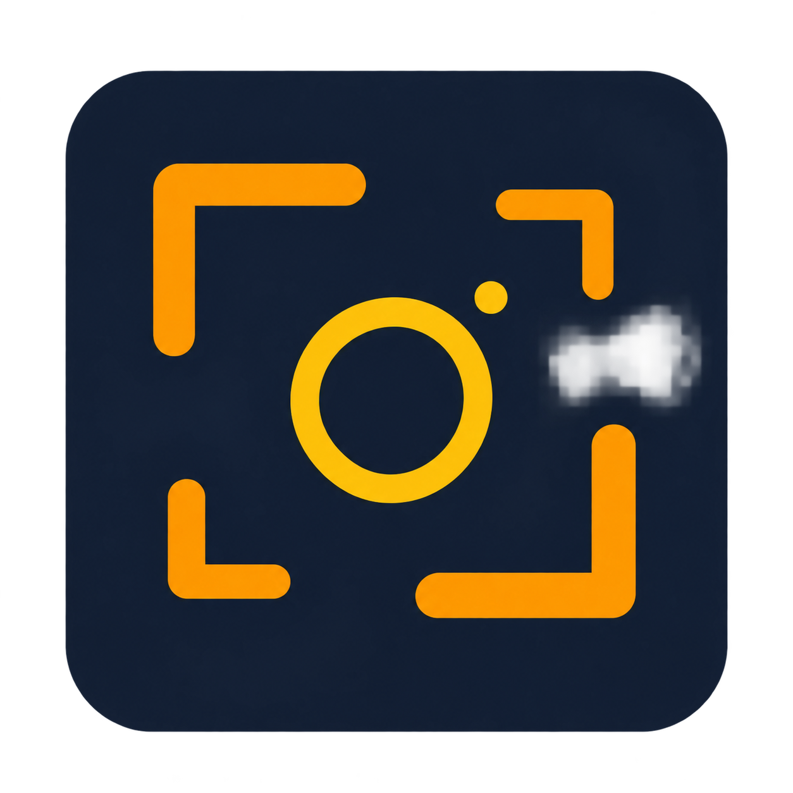

<p align="center">
  
</p>

<h1 align="center">Robot Calibration Workbench</h1>

<p align="center">
  <strong>Calibrate the spatial relationship between an industrial robot and its camera.</strong>
</p>

Robot Calibration Workbench is a C++ toolkit for robot vision calibration. It covers camera
intrinsics, target-based pose estimation, hand-eye calibration, and the analysis needed to
decide whether a calibration result is usable.

The algorithms live in standalone CMake libraries that do not require ROS. The workspace
build and the Qt applications are optional layers on top. Datasets for the hand-eye workflow
ship with the repository, so the examples run without a robot or a camera.

## Components

| Directory | Contents |
| --- | --- |
| `core/` | Data types and shared geometry used by every other component. |
| `optimizations/` | Solvers for camera intrinsics, PnP, hand-eye, and kinematic parameters. |
| `target_finders/` | Target detection. The bundled implementation uses OpenCV. |
| `analysis/` | Reprojection checks, pose differences, and uncertainty analysis. |
| `gui/` | Qt applications for camera intrinsic and hand-eye calibration. |
| `examples/` | Runnable examples, including a hand-eye workflow on bundled data. |

## Requirements

- Linux with a C++17-capable toolchain and CMake.
- OpenCV for the target finder and the examples.
- Qt for the GUI applications.
- ROS 2, `vcs`, `colcon`, and an initialised `rosdep` for the workspace build. The core
  libraries also build as a plain CMake package without ROS.

## Build

Create a workspace, pull the declared dependencies, and build with `colcon`:

```bash
mkdir -p calibration-ws/src
cd calibration-ws
git clone https://github.com/cpp-hardtech/robot-calibration-workbench.git src/calibration_workbench
vcs import src < src/calibration_workbench/dependencies.repos
rosdep install --from-paths src --ignore-src -r -y
colcon build
```

The GUI applications and the examples are controlled by
`CALIBRATION_WORKBENCH_BUILD_GUI` and `CALIBRATION_WORKBENCH_BUILD_EXAMPLES` in the top-level
`CMakeLists.txt`; both default to `ON`. Testing and clang-tidy are behind
`CALIBRATION_WORKBENCH_ENABLE_TESTING` and `CALIBRATION_WORKBENCH_ENABLE_CLANG_TIDY`.

## Run the hand-eye example

The example needs a graphical session. Keep the source checkout in place, because the example
loads its dataset from a path recorded at build time.

```bash
source install/setup.bash
./install/calibration_workbench/lib/calibration_workbench/calibration_workbench_extrinsic_hand_eye
```

It runs against a modified circle grid and a ChArUco grid, prints the estimated transforms and
analysis statistics, and displays the target points reprojected into the input images.

The bundled data is enough to run it without hardware. See
[examples/extrinsic_hand_eye.cpp](examples/extrinsic_hand_eye.cpp) for the source and
[examples/data/](examples/data/) for the datasets.

## Docker

A container definition and a Compose file are provided under `docker/`. The Compose file
builds the image from this repository and mounts the X11 socket so the GUI applications can
start.

```bash
cd docker
docker compose build
docker compose run --rm calibration_workbench
```

## Inspect target detections

Read a target configuration and one image without opening a display. Pass a standalone target
configuration or a calibration YAML with a `target_finder` entry. After sourcing the workspace
environment, run:

```bash
./install/calibration_workbench/lib/calibration_workbench/calibration_workbench_detect_target \
  cal_data.yaml image.png > detections.csv
```

The CSV contains `feature_id,point_index,x,y` with image coordinates in pixels. The command
returns a nonzero status for an unreadable input, a failed detector, or an image with no
detected features.

## Documentation

- [Getting started](docs/page_getting_started.dox)
- [Camera intrinsic calibration](docs/page_camera_intrinsic_calibration.dox)
- [Extrinsic hand-eye calibration](docs/page_extrinsic_hand_eye_calibration.dox)

## Contributing

See [CONTRIBUTING.md](CONTRIBUTING.md).

## License

Distributed under the Apache License, Version 2.0. The original copyright notice and the
full license text are retained in [LICENSE](LICENSE). Provenance and attribution are
documented in [NOTICE](NOTICE).

In accordance with section 4(b) of the License, modification notices are recorded in the
repository history and in NOTICE.
